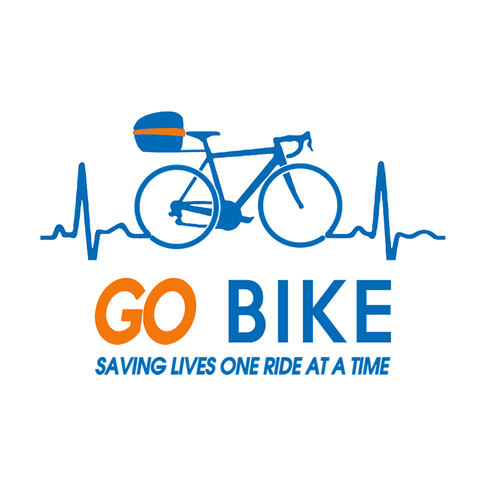

<p align="center">
  
</p>

<h1 align="center">Go Bike</h1>

<p align="center">
  <b>Saving lives one ride at a time.</b><br>
  The Go Bike app for GoBikers and residents.
</p>

<p align="center">
  <a href="https://github.com/localhostJorge/gobikemob/releases/latest/download/GoBike.apk">
    
  </a>
</p>

---

## Thank you for taking part in our survey

To answer the survey, please install Go Bike on your phone and try it first. It takes about
5 minutes. You need:

- An **Android phone** (Android 7.0 or newer). The app is not available on iPhone.
- An **internet connection** (Wi-Fi or mobile data).
- About **150 MB** of free space.

| You are a… | What to do |
|---|---|
| **Resident** | Install the app (steps below), then create a **Resident** account. |
| **GoBiker** | Install the app (steps below), then create a **GoBiker** account. |
| **Admin** | You do not need the app. Use the web admin panel instead ([see below](#for-admins)). |

---

## How to install (Android)

### 1. Download the app

On your Android phone, tap this link:

### 👉 [Download Go Bike (GoBike.apk)](https://github.com/localhostJorge/gobikemob/releases/latest/download/GoBike.apk)

The file is about 63 MB. If your browser asks whether you want to keep or download the file,
tap **Download** or **Download anyway**.

### 2. Open the downloaded file

When the download finishes, tap **Open** in the notification or at the bottom of the
browser. You can also find **GoBike.apk** in your phone's **Files** or **Downloads** app.

### 3. Allow the install

Go Bike is not on the Play Store yet, so Android asks you to allow it once:

1. Android says *"For your security, your phone is not allowed to install unknown apps from
   this source."* Tap **Settings**.
2. Turn on **Allow from this source**.
3. Go back, then tap **Install**.

> If **Google Play Protect** shows a warning such as *"Unsafe app blocked"* or
> *"App scan recommended"*, tap **More details**, then **Install anyway**. This happens
> because the app does not come from the Play Store.

### 4. Open Go Bike

Tap **Open** when the install finishes, or find **Go Bike** on your home screen or in your
app list.

---

## Create your account

1. Open Go Bike. Under *New here?*, tap **Create an account**.
2. Choose your role: **Resident** or **GoBiker**.
3. Fill in your details and add a profile photo, then follow the steps on the screen.
4. When the app asks, **allow location** and **notifications**. Go Bike uses them to show
   GoBikers where they are needed and to send you updates.

**Residents** can use the app right away.

**GoBikers**: a Go Bike admin must approve your account before you can sign in. You will be
able to sign in once your account is approved.

If you already have a Go Bike account, tap **Get Started** and log in instead.

---

## For admins

Admin accounts do not use the mobile app (the app tells admins to use the web admin panel).
Open the admin panel in a web browser on a computer or phone:

### 👉 [gobikeproject.org/admin](https://gobikeproject.org/admin)

Sign in with your admin account.

---

## Updating the app

When there is a new version, download and install it again using the
[same download link](https://github.com/localhostJorge/gobikemob/releases/latest/download/GoBike.apk).
It installs over the old version and keeps your account signed in.

You can find every version on the [Releases page](https://github.com/localhostJorge/gobikemob/releases).

---

## Having trouble?

| Problem | What to try |
|---|---|
| The link opens a page instead of downloading | Open the link in **Chrome**. You can also go to the [Releases page](https://github.com/localhostJorge/gobikemob/releases) and tap **GoBike.apk** under *Assets*. |
| *"App not installed"* | You may have an older test version of Go Bike or the old RondaGo app. Uninstall it first, then install again. Also check that you have enough free space. |
| *"There was a problem parsing the package"* | The download did not finish. Delete **GoBike.apk** and download it again. |
| I can't find the downloaded file | Open the **Files** app (or **My Files**), then **Downloads**. |
| GoBiker: I can't log in | Your account is still waiting for admin approval. Please wait for it to be approved. |
| I'm using an iPhone | Go Bike is only available for Android for now. |

---

<details>
<summary><b>For developers</b></summary>

Go Bike is a Flutter app (Android and iOS) that talks to the Go Bike API at
`https://gobikeproject.org/api`.

```powershell
flutter pub get
flutter run
```

**Release to testers (Firebase App Distribution):** `.\scripts\release.ps1` bumps the
version, builds a signed APK, uploads it to Firebase, then commits and tags the release.
It needs `android/key.properties` (the release signing key) and the Firebase CLI.

**Publish the survey download (GitHub):** create a GitHub release for the tag the release
script made (for example `release-1.0.33`) and attach
`build/app/outputs/flutter-apk/app-release.apk` renamed to **`GoBike.apk`**. The download
link above always points to the newest release's `GoBike.apk`, so the file name must stay the
same.

**App icons:** regenerate with `dart run flutter_launcher_icons` (settings in
`pubspec.yaml`).

</details>
